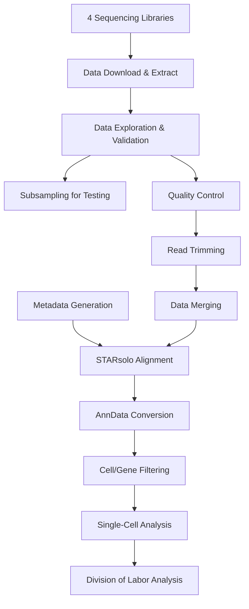

# Bacterial Single-Cell RNA-Seq Analysis Pipeline

This repository contains a complete bioinformatics workflow for analyzing bacterial single-cell RNA sequencing data using the microSPLiT technology. The project investigates division of labor in *Pseudomonas* bacteria through single-cell transcriptome analysis.

## 🧬 Project Overview

### Research Context

This study investigates **intraspecific Division of Labor (DoL)** in bacterial populations using single-cell transcriptomics. Traditional views assumed genetically identical bacterial cells behave uniformly, but evidence shows that even clonal populations can exhibit functional heterogeneity leading to population-level benefits through task specialization.

### Biological Hypothesis

We hypothesize that *Pseudomonas brassicacearum* R401 (*PsR401*) exhibits metabolic cooperation within isogenic populations, particularly under iron-limiting conditions. This bacterium produces three complementary exometabolites:
- **Brassicapeptin:** Phytotoxin for pathogenicity and root colonization
- **DAPG (2,4-diacetylphloroglucinol):** Antimicrobial against competitors  
- **Pyoverdine:** Siderophore for iron chelation in nutrient-limited environments

**Key Question:** Do genetically identical *PsR401* cells specialize in complementary tasks (toxin production, antimicrobial defense, iron acquisition) to enhance population-level fitness under iron stress?

### Experimental Design

**Technology:** microSPLiT (microbial Split-Pool Ligation Transcriptomics) - cutting-edge bacterial single-cell RNA-seq

**Model System:** *Pseudomonas brassicacearum* R401 - robust root colonizer and opportunistic plant pathogen

**Culture Conditions:** 
- **M9:** Iron-limited, low glucose (stringent conditions)
- **M9F:** Iron-replete, high glucose (permissive conditions)

**Experimental Setup:** 18 samples (2 media × 3 biological replicates × 3 timepoints)

**Sequencing:** 4 libraries (BC_0076, BC_0077, BC_0079, BC_0080) containing ~820,800 possible barcode combinations for individual cell identification

## 📊 Complete Workflow Overview

The analysis follows this comprehensive pipeline from raw data to biological insights:



## 🗂️ Repository Structure

### Complete Repository Structure

```
📁 Internship_Val_Goupille_2025/
├── 📄 README.md                        # Main documentation (this file)
├── 📄 CLAUDE.md                        # AI assistant instructions
├── 📁 code/                            # All analysis code
│   ├── 📁 HPC_analysis/                # High-performance computing scripts
│   │   ├── 📁 0_useful_scripts/        # Utility scripts (download, extract, merge)
│   │   ├── 📁 1_QC_multiqc_fastqc/     # Quality control pipeline
│   │   ├── 📁 2_trimming/              # Read trimming pipeline
│   │   └── 📁 3_barcodes_and_alignment/ # STARsolo alignment pipeline
│   └── 📁 Local_analysis/              # Python/R analysis scripts
│       ├── 📄 1_barcode_processing.py   # Extract cell barcodes
│       ├── 📄 2a_starsolo_to_anndata.py # Convert to AnnData format
│       ├── 📄 3a-3c_filtering_*.py      # Quality filtering pipeline
│       ├── 📄 4a_anndata_to_RDS.py      # Convert to Seurat format
│       ├── 📄 6a-7_*.ipynb              # Analysis notebooks
│       ├── 📁 BacSC/                   # Custom bacterial scRNA-seq module
│       └── 📁 interactive_notebooks/   # Interactive versions of analysis scripts
├── 📁 data/                            # All data organized by processing stage
│   ├── 📁 subsampled_data/             # Test datasets (5000 reads)
│   ├── 📁 barcodes_result/             # Cell barcode extraction results
│   ├── 📁 STARsolo_result/             # Genome alignment results
│   ├── 📁 Anndata/                     # Single-cell data objects (Python)
│   ├── 📁 RDS/                         # Seurat objects (R)
│   ├── 📁 QC_file/                     # Quality control reports
│   ├── 📁 genome_annotation/           # Reference genome files
│   ├── 📁 info/                        # Configuration files (YAML)
│   └── 📁 meta/                        # Experimental metadata
├── 📁 internship_deliverables/         # Academic deliverables
│   ├── 📁 Msc_thesis/                  # Complete thesis (Quarto format)
│   ├── 📄 Msc_thesis_Valentin_Goupille_2025.pdf
│   └── 📄 Oral_Valentin_GOUPILLE.pdf
└── 📁 misc/                            # Supplementary materials
    ├── 📁 supplementary_code/          # Additional analysis scripts
    ├── 📁 interim_meetings/            # Meeting presentations
    └── 📁 obsidian/                    # Research notes
```

### Core Directories

- **`code/HPC_analysis/`** - High-performance computing scripts (run on server)
- **`code/Local_analysis/`** - Local analysis scripts (Python/Jupyter)
- **`data/`** - All data files organized by processing stage
- **`internship_deliverables/`** - Thesis and presentation materials

### Interactive Analysis System

**Python Scripts & Jupyter Integration:**
- Most Python scripts in `code/Local_analysis/` are designed to work interactively
- Corresponding Jupyter notebooks in `code/Local_analysis/interactive_notebooks/` provide:
  - **Interactive execution** with cell-by-cell running
  - **Rich visualizations** (plots, graphs, interactive figures)
  - **Step-by-step exploration** of data processing
  - **Real-time parameter adjustment**

**Visualization Features:**
- Quality control plots and filtering statistics
- Gene expression distributions and scatter plots  
- Cell clustering and dimensionality reduction (PCA, UMAP)
- Growth curves and experimental condition comparisons
- Interactive exploration of single-cell data

**ℹ️ Info:** For optimal analysis experience, use Jupyter Lab to open notebooks in `code/Local_analysis/interactive_notebooks/` - this allows you to see all visualizations and interact with the data processing steps.

### Data Organization

```
data/
├── subsampled_data/first_reads/     # Test datasets (5000 reads)
├── barcodes_result/                 # Extracted cell barcodes and metadata
├── STARsolo_result/                 # Alignment results and processing logs
├── Anndata/                         # Single-cell data objects (raw/filtered/with_metadata)
├── RDS/                             # Seurat objects for R analysis
├── QC_file/                         # Quality control reports (MultiQC/FastQC)
├── genome_annotation/               # Reference genome annotation files
├── genome_ref/                      # Reference genome sequence
├── info/                            # YAML configuration files (experiment/samples)
└── meta/                            # Experimental metadata spreadsheets
```

## 📥 Data Preparation Steps (Preliminary)

Before starting the main analysis pipeline, several preliminary steps were necessary to prepare the raw sequencing data:

### Step 0: Data Acquisition and Preparation

**Location:** `code/HPC_analysis/0_useful_scripts/`

#### 0.1 Data Download
**Purpose:** Download sequencing data from external repositories

**Scripts:** `download_and_transfert_data/`
- `download_script.sh` - Download raw FASTQ files with retry mechanism
- `transfert_data_repo_to_repo.sh` - Transfer between storage locations

**ℹ️ Info:** Starting from 4 demultiplexed bacterial libraries (BC_0076, BC_0077, BC_0079, BC_0080) sequenced as paired-end reads, we downloaded the raw data files.

#### 0.2 Data Extraction and Decompression  
**Purpose:** Extract compressed archives and decompress FASTQ files

**Scripts:** `extract_decompress/`
- `extract_script.sh` - Extract ZIP archives containing sequencing data
- `decompress_fastq.sh` - Decompress FASTQ.gz files for processing

**Output:** `data/raw_data/unzipped_data/fastq/` - Decompressed FASTQ files

#### 0.3 Data Exploration
**Purpose:** Inspect and validate file contents before processing

**Scripts:** `explore_files/`
- `list_zip.sh` - Examine archive contents
- `view_fastq_head.sh` - Preview FASTQ file structure

**ℹ️ Info:** Critical step to verify data integrity and understand file structure.

#### 0.4 Test Dataset Creation
**Purpose:** Create smaller datasets for pipeline development and testing

**Scripts:** `create_subsamples_fastq_reads/`
- `first_reads/extract_first_reads.py` - Extract first 5000 reads per sample
- `random_reads/run_subsampling_random.sh` - Random read sampling

**Output:** `data/subsampled_data/first_reads/5000_reads/` - Test datasets

**ℹ️ Info:** Essential for testing analysis pipelines without using full datasets (saves time and computational resources).

#### 0.5 Data Merging
**Purpose:** Combine individual samples into merged datasets  

**Scripts:** `merge_fastq/`
- `merge_fastq_wrapper.sh` - Merge all R1 files together, all R2 files together

**Output:** `data/merged_data/merged_trimmed-R1/R2.fastq.gz`

**ℹ️ Info:** Creates consolidated datasets for population-level analysis while preserving individual cell barcodes.

---

## 🔬 Main Analysis Pipeline

### Step 1: Quality Control
**Purpose:** Assess sequencing quality before processing

**Location:** `code/HPC_analysis/1_QC_multiqc_fastqc/`

**Usage:**
```bash
# QC on raw data
./launch_multiQC_jobs.sh --data_type unzipped --read_type both

# QC on test data (faster)
./launch_multiQC_jobs.sh --data_type subsampled --read_type both
```

**Output:** HTML reports in `data/QC_file/multiqc_results_*/`

**ℹ️ Info:** Open the HTML reports in your browser to see:
- Read quality scores
- GC content distribution
- Adapter contamination
- Sequence duplication levels

---

### Step 2: Metadata Generation (Local)
**Purpose:** Generate cell barcodes and metadata for STARsolo alignment and AnnData integration

**Location:** `code/Local_analysis/1_barcode_processing.py`

**Background:** microSPLiT uses 3 rounds of barcoding to uniquely identify each cell. This script generates cell barcodes and creates metadata used in two key steps:
1. **STARsolo alignment:** Provides barcode files for cell identification
2. **AnnData integration:** Supplies experimental conditions metadata (M9 vs M9F, timepoints, replicates)

**Usage:**
```bash
python 1_barcode_processing.py
```

**Input:** `data/meta/metadata_DOL_rep1.xlsx`

**Output:** 
- `data/barcodes_result/barcodeSTARsolo/filtered/` - Clean barcodes for STARsolo alignment
- `data/barcodes_result/metadata_DOL_Exp1_complete.csv` - Cell metadata with experimental conditions

**ℹ️ Info:** This creates the essential link between barcode combinations, individual cells, and their experimental conditions (media type, timepoint, replicate).

---

### Step 3: Read Trimming
**Purpose:** Remove adapters and low-quality sequences

**Location:** `code/HPC_analysis/2_trimming/`

**Usage:**
```bash
# Trim individual samples
./Trim.sh --input-type unzipped --cpus 32 --mem 200G

# Trim test data (faster)
./Trim.sh --input-type subsampled --cpus 16 --mem 50G
```

**Output:** `data/Trim_process/RUN_ID/unzipped/SAMPLE/`

**ℹ️ Info:** This is like "cleaning" the sequencing reads by removing technical sequences that aren't biological.

---

### Step 4: Genome Alignment & Quantification
**Purpose:** Map reads to the bacterial genome and count gene expression

**Location:** `code/HPC_analysis/3_barcodes_and_alignment/STARsolo/`

**Background:** This is the core step where we align reads to the *Pseudomonas* genome and count how many reads map to each gene in each cell. The 4 trimmed libraries (BC_0076, BC_0077, BC_0079, BC_0080) are merged into a single R1 file and a single R2 file before alignment.

**Usage:**
```bash
# Main analysis (all samples merged)
sbatch starsolo_microsplit_pipeline.sh
```

**Requirements:**
- 600GB memory allocation
- Uses merged dataset: `data/merged_data/merged_trimmed-R1/R2.fastq.gz`
- Cell barcodes from Step 2

**Output:** `data/STARsolo_result/merged_trimmed/merged/`
- `Solo.out/GeneFull/filtered/` - Expression matrix (genes × cells)
- `Solo.out/GeneFull/raw/` - Unfiltered data
- Log files with alignment statistics

**ℹ️ Info:** This creates a table where rows are genes, columns are cells, and values are expression counts.

---

### Step 5: Data Conversion
**Purpose:** Convert alignment results to Python or R format for analysis

**Location:** `code/Local_analysis/2a_starsolo_to_anndata.py`

#### 5a. Python Format (AnnData)
**Usage:**
```bash
python 2a_starsolo_to_anndata.py
```

**Input:** STARsolo results from Step 4

**Output:** `data/Anndata/raw/` 
- 6 different data objects (Gene/GeneFull, raw/filtered, different matrix types)
- Main file: `GeneFull_filtered.h5ad`

**ℹ️ Info:** Converts the data into AnnData format for Python-based analysis with Scanpy.


### Step 6: Quality Filtering
**Purpose:** Remove low-quality cells and genes

**Location:** `code/Local_analysis/3a_filtering_100UMIs.py`, `3b_filtering_advanced_cell_v2.py`, `3c_filtering_advanced_gene.py`

**Sequential filtering:**

1. **Basic UMI filtering (3a):**
   ```bash
   python 3a_filtering_100UMIs.py
   ```
   Removes cells with <100 UMIs (unique molecular identifiers)

2. **Advanced cell filtering (3b):**
   ```bash
   python 3b_filtering_advanced_cell_v2.py  
   ```
   Removes doublets, low-quality cells based on multiple metrics

3. **Advanced gene filtering (3c):**
   ```bash
   python 3c_filtering_advanced_gene.py
   ```
   - Filters to protein-coding genes only
   - Removes genes expressed in <5 cells (lowly expressed)
   - Adds gene annotations for different expression thresholds (5%, 10%, 15%)
   - Generates comprehensive filtering statistics and visualizations

**Output:** `data/Anndata/filtered/` - High-quality single-cell dataset

**ℹ️ Info:** This removes "bad" cells (e.g., dying cells, technical artifacts) and uninformative genes, keeping only reliable data for biological interpretation.

---

### Step 6b: R Format Conversion (Optional)
**Purpose:** Convert filtered AnnData to Seurat format for R-based analysis

**Location:** `code/Local_analysis/4a_anndata_to_RDS.py`

**Usage:**
```bash
python 4a_anndata_to_RDS.py
```

**Input:** `data/Anndata/filtered/GeneFull_raw_unique_mult_with_metadata_grouped_filtered_100UMI_3c.h5ad`

**Output:** `data/RDS/GeneFull_raw_unique_mult_with_metadata_grouped_filtered_100UMI_3c_SeuratV5.rds`

**ℹ️ Info:** This script converts the filtered Python dataset to Seurat V5 format for researchers who prefer R-based analysis. The conversion preserves all cell and gene metadata, making it compatible with standard Seurat workflows.

---

### Step 7: Single-Cell Analysis
**Purpose:** Identify cell types, gene expression patterns, and biological insights

#### Python-Based Analysis
**Location:** `code/Local_analysis/`

**Main notebooks:**
- `6a_scanpy.ipynb` - Standard single-cell analysis
- `6b_Global_BacSC_tutorial_general_Val.ipynb` - Bacterial-specific analysis

**Interactive development notebooks:**
- `interactive_notebooks/` - Interactive versions of analysis scripts for step-by-step exploration

#### R-Based Analysis (Alternative)
**Notebook:** `code/Local_analysis/7_seurat.ipynb`

**ℹ️ Info:** For R users, you can use the RDS file generated in Step 5b with standard Seurat workflows or the provided Seurat notebook.

### Typical Analysis Workflow:

**Standard Single-Cell Analysis:**
- **Dimensionality reduction** (PCA, UMAP) 
- **Cell clustering** to identify subpopulations
- **Differential expression analysis** between conditions
- **Pathway enrichment** for biological interpretation

**Division of Labor Detection:**
- **Subpopulation identification** specialized in different metabolic tasks
- **Iron-responsive gene expression** patterns
- **Exometabolite production** specialization (Brassicapeptin, DAPG, Pyoverdine)
- **Noise-driven vs. environmental** specialization mechanisms

**ℹ️ Info:** The key biological questions addressed:
- Do *PsR401* cells specialize in complementary functions?
- Is specialization driven by iron limitation or inherent noise?
- How does transcriptional heterogeneity enhance population fitness?
- Which genes/pathways control metabolic cooperation?

## 🔄 Recommended Analysis Workflow

### For First-Time Users (Complete Workflow):

**If starting from raw archives:**

1. **Prepare data (if needed):**
   ```bash
   cd code/HPC_analysis/0_useful_scripts/
   
   # Extract compressed data
   ./extract_decompress/extract_script.sh
   
   # Create test datasets (recommended for first run)
   ./create_subsamples_fastq_reads/first_reads/run_extract_reads.sh
   
   # Merge individual samples (optional, for population analysis)
   ./merge_fastq/merge_fastq_wrapper.sh
   ```

2. **Start with test data:**
   ```bash
   # Use subsampled data (5000 reads) for faster testing
   ./launch_multiQC_jobs.sh --data_type subsampled --read_type both
   ```

3. **Process barcodes:**
   ```bash
   cd code/Local_analysis/
   python 1_barcode_processing.py
   ```

4. **Run main analysis:**
   ```bash
   cd ../HPC_analysis/3_barcodes_and_alignment/STARsolo/
   sbatch starsolo_microsplit_pipeline.sh
   ```

5. **Convert and filter data:**
   ```bash
   cd ../../../Local_analysis/
   python 2a_starsolo_to_anndata.py
   python 3a_filtering_100UMIs.py
   python 3b_filtering_advanced_cell_v2.py  
   python 3c_filtering_advanced_gene.py
   
   # Optional: Convert to R format for Seurat users
   python 4a_anndata_to_RDS.py
   ```

6. **Analyze results:**
   ```bash
   # For Python analysis
   jupyter lab
   # Open 6b_Global_BacSC_tutorial_general_Val.ipynb
   
   # For R analysis (alternative)
   # Open 7_seurat.ipynb or use the RDS file in R directly
   
   # For reproducible analysis (recommended)
   # Use dev containers - see "Reproducible Development Environment" section
   ```

### For Production Analysis:

Use the full dataset by replacing `subsampled` with `unzipped` or using the merged data directly.

## 📋 Key Files for Biologists

**Configuration:**
- `data/info/samples/samples_trimming.yaml` - File paths and sample information
- `data/meta/metadata_DOL_rep1.xlsx` - Experimental metadata

**Results:**
- `data/QC_file/multiqc_results_*/multiqc_report.html` - Quality control reports
- `data/STARsolo_result/merged_trimmed/merged/starsolo_output2/Log.final.out` - Alignment statistics
- `data/Anndata/filtered/` - Final filtered datasets for Python analysis (Scanpy)
- `data/RDS/` - Seurat objects for R analysis (optional)

**Analysis:**
- `code/Local_analysis/` - Main analysis notebooks (6a, 6b, 7)
- `code/Local_analysis/interactive_notebooks/` - Interactive development notebooks
- `internship_deliverables/` - Final thesis and presentations

## ⚠️ Important Notes

**Data Size:** Many data files are >100MB and excluded from this GitHub repository. The actual data resides on the HPC server.

**Prerequisites:**
- Access to HPC cluster with SLURM scheduler
- Conda/Mamba for environment management
- Python 3.8+ with scientific libraries (scanpy, anndata, pandas)
- R 4.0+ with Seurat V5 (optional, for R-based analysis)
- rpy2 (for Python-to-R conversion, if using RDS conversion)

**Memory Requirements:**
- QC: 2-16GB per sample
- Trimming: 50-200GB per sample  
- STARsolo: 600GB (merged analysis)
- Local analysis: 8-32GB

## 🐳 Reproducible Development Environment

### Dev Containers for Local Analysis

**Purpose:** Ensure consistent software versions and reproducible analysis across different systems

**FAIR Principles Benefits:**
- **Findable:** Standardized environment definitions make dependencies explicit
- **Accessible:** Container images can be shared and run on any Docker-compatible system
- **Interoperable:** Consistent versions prevent compatibility issues between tools
- **Reusable:** Exact environment can be recreated anywhere for validation or extension

**Setup:**
1. **Prerequisites:**
   - Docker Desktop
   - Visual Studio Code
   - Dev Containers extension for VS Code

2. **Usage:**
   ```bash
   # Clone repository
   git clone https://github.com/vgoupille/Internship_Val_Goupille_2025.git
   cd Internship_Val_Goupille_2025
   
   # Open in VS Code
   code .
   
   # VS Code will detect .devcontainer/ and prompt to reopen in container
   # Or use Command Palette: "Dev Containers: Reopen in Container"
   ```

**What's included:**
- **R environment:** Rocker Project base with Seurat V5, BioConductor packages
- **Python environment:** Scientific stack (scanpy, anndata, pandas, jupyter)
- **Version control:** Locked package versions ensure reproducibility
- **Jupyter Lab:** Pre-configured for interactive analysis

**ℹ️ Info:** The development container ensures that everyone working with this dataset uses identical software versions. This eliminates "it works on my machine" problems and makes the analysis fully reproducible according to FAIR data principles.

**Configuration:** Based on the Rocker Project (https://rocker-project.org/images/devcontainer/features.html)

---

## 📚 Additional Resources

- **Technical documentation:** `CLAUDE.md`
- **Environment setup:** `code/HPC_analysis/*/create_env_*.sh`
- **Thesis:** `internship_deliverables/Msc_thesis/`

## 🤝 Support

For questions about the biological interpretation of results, consult the thesis document. For technical issues with the pipeline, check the individual README files in each analysis directory.

---
*This pipeline was developed for analyzing bacterial single-cell RNA-seq data to investigate division of labor in Pseudomonas bacteria.*