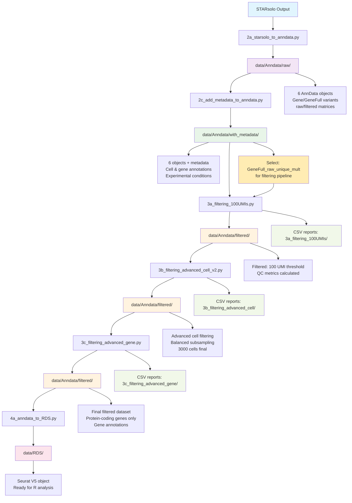

# AnnData Organization Structure

This directory contains the structured organization of AnnData objects created during the single-cell analysis pipeline.

## 📁 Directory Structure

```
data/
├── Anndata/       # Organized Python AnnData objects
│   ├── raw/       # Raw AnnData objects created from STARsolo output (script 2a)
│   ├── with_metadata/ # Objects enriched with cell and gene metadata (script 2c)
│   ├── filtered/  # Filtered objects from various steps (scripts 3a, 3b, 3c)
│   │   ├── csv/   # CSV reports organized by step
│   │   │   ├── 3a_filtering_100UMIs/
│   │   │   ├── 3b_filtering_advanced_cell/
│   │   │   └── 3c_filtering_advanced_gene/
│   │   └── *.h5ad # Filtered AnnData files
│   └── README.md  # This documentation
└── RDS/          # R objects (RDS format) for integration with Seurat/R
    └── README.md # RDS documentation
```

> **Note:** RDS objects are stored in a separate `data/RDS/` folder to facilitate integration with R analyses (Seurat, SingleCellExperiment, etc.).

## 🔄 Processing Pipeline



## 📊 Directory Contents

### 📁 `raw/` - Raw AnnData Objects
**Source script:** `2a_starsolo_to_anndata.py`

Contains 6 AnnData objects created directly from STARsolo output:

| File | Description |
|------|-------------|
| `Gene_raw_matrix.h5ad` | Raw Gene matrix (integer counts) |
| `Gene_raw_unique_mult.h5ad` | Raw Gene matrix (UniqueAndMult-Uniform) |
| `Gene_filtered.h5ad` | Filtered Gene matrix |
| `GeneFull_raw_matrix.h5ad` | Raw GeneFull matrix (integer counts) |
| `GeneFull_raw_unique_mult.h5ad` | Raw GeneFull matrix (UniqueAndMult-Uniform) |
| `GeneFull_filtered.h5ad` | Filtered GeneFull matrix |

### 📁 `with_metadata/` - Objects with Metadata
**Source script:** `2c_add_metadata_to_anndata.py`

Contains the same 6 objects enriched with:

**Cell metadata:**
- Experimental information (conditions, culture media)
- Well positions (Well_loc_rd1, Well_loc_rd2, Well_loc_rd3)
- Derived variables (RepTech, RepBio, etc.)

**Gene metadata:**
- NCBI annotations (gene type, description, etc.)
- Final gene names (`final_gene_name`)

### 📁 `filtered/` - Filtered Objects
**Source scripts:** `3a_filtering_100UMIs.py`, `3b_filtering_advanced_cell_v2.py`, `3c_filtering_advanced_gene.py`

Contains filtered objects from different steps:

| File | Description | Source |
|------|-------------|---------|
| `GeneFull_raw_unique_mult_with_metadata_grouped_filtered_100UMI.h5ad` | UMI ≥100 filtering | 3a |
| `GeneFull_raw_unique_mult_with_metadata_grouped_filtered_100UMI_3b_v2.h5ad` | Advanced cell filtering | 3b |
| `GeneFull_raw_unique_mult_with_metadata_grouped_filtered_100UMI_3c.h5ad` | Final gene filtering | 3c |

**CSV reports organized by step:**

#### 📁 `csv/3a_filtering_100UMIs/`
- `GeneFull_raw_unique_mult_with_metadata_grouped_filtered_100UMI_filtering_stats.csv` - UMI filtering statistics
- `GeneFull_raw_unique_mult_with_metadata_grouped_filtered_100UMI_metadata.csv` - Cell metadata

#### 📁 `csv/3b_filtering_advanced_cell/`
- `filtering_summary_report_v2.csv` - Advanced cell filtering summary

#### 📁 `csv/3c_filtering_advanced_gene/`
- `gene_filtering_summary_report.csv` - Gene filtering summary
- `gene_annotation_summary.csv` - Gene annotation summary

## 🔧 Processing Scripts

### 1. `2a_starsolo_to_anndata.py`
**Objective:** Convert STARsolo output to AnnData objects  
**Output:** `data/Anndata/raw/`

- Creates 6 different AnnData objects
- Handles integer and float matrices
- Transposes matrices for AnnData format (cells × genes)
- Modifies gene names (removes "gene-", replaces _ with -)

### 2. `2c_add_metadata_to_anndata.py`
**Objective:** Add cell and gene metadata  
**Input:** `data/Anndata/raw/`  
**Output:** `data/Anndata/with_metadata/`

- Adds experimental metadata from BarQC files
- Enriches with NCBI annotations
- Creates barcode-well mappings
- Adds processing information

### 3. `3a_filtering_100UMIs.py`
**Objective:** Initial cell filtering (100 UMI threshold)  
**Input:** `data/Anndata/with_metadata/`  
**Output:** `data/Anndata/filtered/`

- Filters cells with <100 UMI
- Calculates QC metrics
- Creates `Group` variable from `OD`
- Generates visualizations

### 4. `3b_filtering_advanced_cell_v2.py`
**Objective:** Advanced cell filtering  
**Input:** `data/Anndata/filtered/`  
**Output:** `data/Anndata/filtered/`

- Balanced subsampling (4000 → 3000 cells)
- RepTech filtering (≥20 cells per group)
- RepTech outlier removal
- Maintains balance between conditions

### 5. `3c_filtering_advanced_gene.py`
**Objective:** Final gene filtering  
**Input:** `data/Anndata/filtered/`  
**Output:** `data/Anndata/filtered/`

- Protein-coding genes only filtering
- Minimum cells per gene filtering (≥5 cells)
- Expression group annotations
- Gene quality metrics

### 6. `4a_anndata_to_RDS.py`
**Objective:** Convert filtered AnnData objects to RDS for R integration  
**Input:** `data/Anndata/filtered/`  
**Output:** `data/RDS/`

- Converts AnnData objects to Seurat V5 format
- Preserves all cell and gene metadata
- Uses rpy2 for Python-R interface
- Generates RDS objects ready for R analysis

## 🎯 Advantages of This Organization

### 🔍 **Clarity and Traceability**
- Clear separation by processing stage
- Complete transformation history
- Detailed report files

### 📚 **Navigation Ease**
- Intuitive structure by processing level
- Descriptive file names
- Integrated documentation

### 🔄 **Maintenance and Evolution**
- Easy addition of new steps
- Independent script modification
- Selective re-execution possible

### 🚀 **Performance**
- Avoids unnecessary recalculations
- Direct access to intermediate steps
- Resource optimization

## 📊 File Statistics

| Directory | .h5ad Files | .csv Files | .rds Files | Total Size |
|-----------|-------------|------------|------------|------------|
| `Anndata/raw/` | 6 | 0 | 0 | ~1.7 GB |
| `Anndata/with_metadata/` | 6 | 0 | 0 | ~1.9 GB |
| `Anndata/filtered/` | 3 | 0 | 0 | ~285 MB |
| `Anndata/filtered/csv/` | 0 | 5 | 0 | ~20 MB |
| `RDS/` | 0 | 0 | 1+ | ~50 MB |

**CSV Reports Detail:**
- `filtered/csv/3a_filtering_100UMIs/` : 2 CSV files
- `filtered/csv/3b_filtering_advanced_cell/` : 1 CSV file  
- `filtered/csv/3c_filtering_advanced_gene/` : 2 CSV files

**RDS Objects:**
- Seurat V5 objects converted from filtered AnnData
- Compatible with R/Seurat for advanced analyses

## 📈 Naming Convention

Files follow a descriptive naming pattern:
- `*_raw_*` - Raw data
- `*_with_metadata` - With added metadata
- `*_filtered_*` - Various filtering levels applied
- `*_3a`, `*_3b_v2`, `*_3c` - Suffixes indicating source script

## 🎯 Usage

To use this structure:

1. **Execute scripts in order:**
   ```bash
   python code/Local_analysis/2a_starsolo_to_anndata.py
   python code/Local_analysis/2c_add_metadata_to_anndata.py
   python code/Local_analysis/3a_filtering_100UMIs.py
   python code/Local_analysis/3b_filtering_advanced_cell_v2.py
   python code/Local_analysis/3c_filtering_advanced_gene.py
   python code/Local_analysis/4a_anndata_to_RDS.py
   ```

2. **Load objects as needed:**
   ```python
   import anndata as ad
   
   # Raw object
   adata_raw = ad.read_h5ad("data/Anndata/raw/GeneFull_raw_unique_mult.h5ad")
   
   # Object with metadata
   adata_meta = ad.read_h5ad("data/Anndata/with_metadata/GeneFull_raw_unique_mult_with_metadata.h5ad")
   
   # Final filtered object
   adata_final = ad.read_h5ad("data/Anndata/filtered/GeneFull_raw_unique_mult_with_metadata_grouped_filtered_100UMI_3c.h5ad")
   ```

3. **Use RDS objects in R:**
   ```r
   # Load Seurat object
   library(Seurat)
   seurat_obj <- readRDS("data/RDS/GeneFull_raw_unique_mult_with_metadata_grouped_filtered_100UMI_3c_SeuratV5.rds")
   
   # Access data
   counts <- seurat_obj[["RNA"]]@counts
   cell_metadata <- seurat_obj@meta.data
   gene_metadata <- seurat_obj[["RNA"]]@meta.data
   ```

---

**Author:** Valentin Goupille  
**Date:** 2025-07-18  
**Project:** Division of Labor - Single Cell Analysis