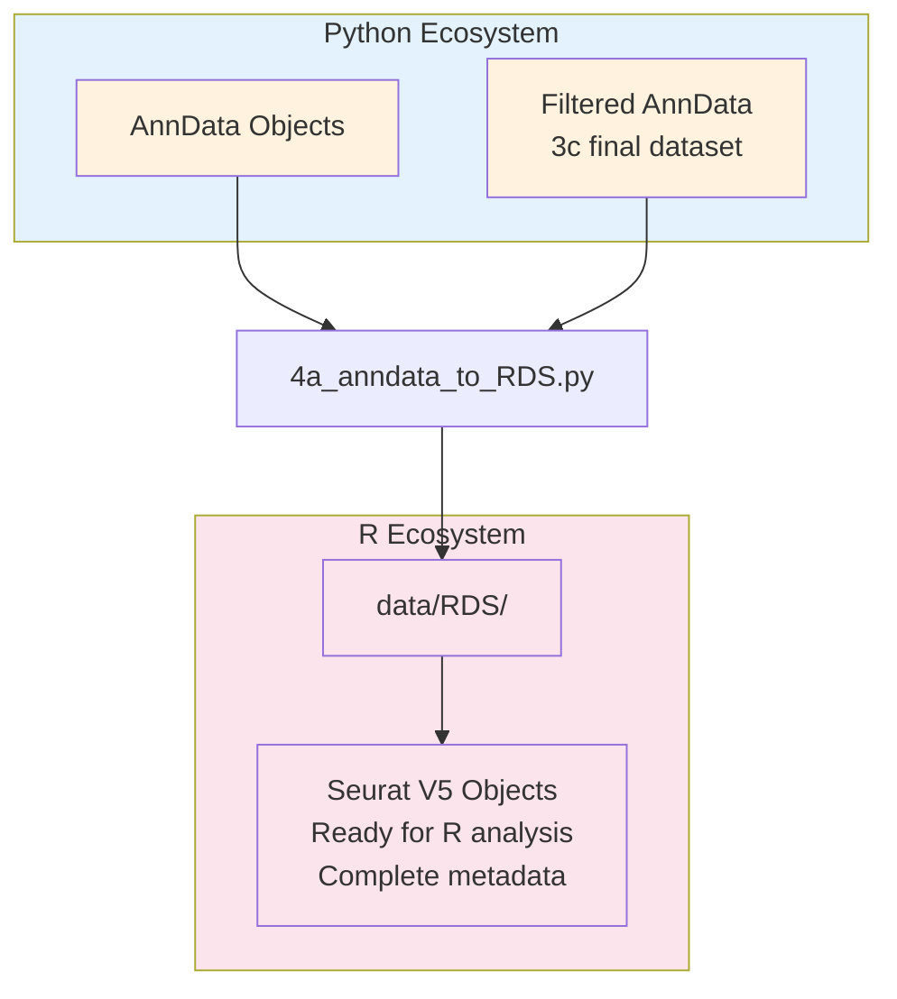

# RDS Objects Directory

This directory contains R objects (RDS format) converted from AnnData objects for seamless integration with R analysis workflows.

## 🔄 Processing Pipeline



## 🎯 Purpose

The RDS format enables seamless integration with R analysis tools, particularly:
- **Seurat** for single-cell RNA-seq analysis
- **SingleCellExperiment** for Bioconductor workflows
- **Custom R scripts** for downstream analysis

## 📋 File Naming Convention

RDS files follow this pattern:
```
[original_anndata_name]_[conversion_target].rds
```

Examples:
- `GeneFull_raw_unique_mult_with_metadata_grouped_filtered_100UMI_3c_SeuratV5.rds`
- `GeneFull_raw_unique_mult_with_metadata_grouped_filtered_100UMI_3c_SCE.rds`

## 🔧 Source Scripts

- `4a_anndata_to_RDS.py` - Converts AnnData to Seurat V5 objects

## 💻 Usage in R

```r
# Load Seurat object
library(Seurat)
seurat_obj <- readRDS("data/RDS/GeneFull_raw_unique_mult_with_metadata_grouped_filtered_100UMI_3c_SeuratV5.rds")
print(seurat_obj)

# Access components
counts <- seurat_obj[["RNA"]]@counts
cell_metadata <- seurat_obj@meta.data
gene_metadata <- seurat_obj[["RNA"]]@meta.data

# Basic analysis
VlnPlot(seurat_obj, features = c("nFeature_RNA", "nCount_RNA"))
seurat_obj <- FindVariableFeatures(seurat_obj)
seurat_obj <- ScaleData(seurat_obj)
seurat_obj <- RunPCA(seurat_obj)
seurat_obj <- RunUMAP(seurat_obj, dims = 1:10)
```

## 🏗️ Integration with Pipeline

This directory is part of the organized data structure:
```
data/
├── Anndata/       # Python AnnData objects
│   ├── raw/
│   ├── with_metadata/
│   ├── filtered/
│   └── README.md
└── RDS/          # R objects (RDS format)
    └── README.md
```

## 📊 Object Contents

RDS objects contain:
- **Expression matrix** - Gene × Cell count matrix
- **Cell metadata** - All experimental conditions, QC metrics, and derived variables
- **Gene metadata** - NCBI annotations, gene types, and filtering annotations
- **Processing history** - Information about filtering steps applied

## 🔍 Data Verification

To verify the integrity of converted objects:

```r
# Check dimensions
dim(seurat_obj)

# Verify metadata
head(seurat_obj@meta.data)
colnames(seurat_obj@meta.data)

# Check gene metadata
head(seurat_obj[["RNA"]]@meta.data)
colnames(seurat_obj[["RNA"]]@meta.data)

# Verify non-zero counts
sum(seurat_obj[["RNA"]]@counts > 0)
```

## 🎯 Advantages

- **Native R integration** - Direct compatibility with R/Seurat workflows
- **Preserved metadata** - All cell and gene annotations maintained
- **Memory efficient** - Sparse matrix storage
- **Version compatibility** - Seurat V5 format for latest features

---

**Note:** RDS files are generated from the filtered AnnData objects and contain all metadata from the original objects. The conversion preserves the complete analysis pipeline history while enabling seamless transition to R-based analyses.

**Author:** Valentin Goupille  
**Date:** 2025-01-13  
**Project:** Division of Labor - Single Cell Analysis
