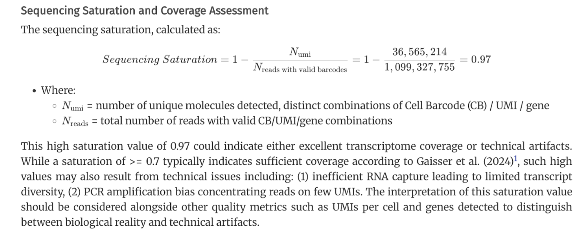

## Appendix B:  {#appendix-b}

::: {.content-visible when-format="html"}
#### MultiQC Report R1 Before Trimming

Click to view MultiQC report R1 before trimming

<iframe src="../data/multiqc/multiqc_report_pre_R1.html" width="100%" height="800px" frameborder="0" loading="lazy">

</iframe>

#### MultiQC Report R1 After Trimming

Click to view MultiQC report R1 after trimming

<iframe src="../data/multiqc/multiqc_report_post_R1.html" width="100%" height="800px" frameborder="0" loading="lazy">

</iframe>

#### MultiQC Report R2 Before Trimming

Click to view MultiQC report R2 before trimming

<iframe src="../data/multiqc/multiqc_report_pre_R2.html" width="100%" height="800px" frameborder="0" loading="lazy">

</iframe>

#### MultiQC Report R2 After Trimming

Click to view MultiQC report R2 after trimming

<iframe src="../data/multiqc/multiqc_report_post_R2.html" width="100%" height="800px" frameborder="0" loading="lazy">

</iframe>

:::

## warning 
!!!!! WARNING: while processing sjdbGTFfile=/projects/microsplit/data/processed_data/STARsolo_result/merged_trimmed/merged/raw_data/genome_annotation/genome_annotation_*PsR401*_fixed.gtf, line:
CP125962.1	Genbank	exon	298557	300953	.	-	0	transcript_id "gene-QLH64_29550"; gene_id "gene-QLH64_29550"; gene_name "QLH64_29550";
 exon end = 300953 is larger than the chromosome CP125962.1 length = 299955 , will skip this exon

Log of the STARsolo run : 
Alignment statistics:
-----------------------
                          Number of input reads |	1284475633
                      Average input read length |	135
                   Uniquely mapped reads number |	46733841
                        Uniquely mapped reads % |	3.64%
        Number of reads mapped to multiple loci |	1103762730
             % of reads mapped to multiple loci |	85.93%
                Number of reads unmapped: other |	128049614
                     % of reads unmapped: other |	9.97%
                      Mismatch rate per base, % |	0.38%
Fri May 30 15:39:42 CEST 2025 - Pipeline completed!

### STARsolo KneePant filtering results {#sec-appendix-starsolo-kneepant}

As a comparison to our custom filtering approach, we also analyzed the data using STARsolo's default KneePant filtering method. The following table presents the results obtained with this alternative filtering strategy:

| Metric                                    | Value         | Biological Significance |
|-------------------------------------------|---------------|------------------------|
| **Estimated Number of Cells**             | 27,203        | Large population for DoL analysis |
| **Mean Reads per Cell**                   | 470           | Good coverage depth |
| **Median Reads per Cell**                 | 381           | Consistent coverage |
| **Mean UMI per Cell**                     | 465           | Reliable molecular counting |
| **Median UMI per Cell**                   | 378           | Consistent UMI distribution |
| **Mean Genes per Cell**                   | 296           | Rich transcriptional profiles |
| **Median Genes per Cell**                 | 258           | Consistent gene detection |
| **Total Genes Detected**                  | 6,035         | Comprehensive gene coverage |

: STARsolo KneePant filtering results for comparison {#tbl-starsolo-kneepant}

*Results obtained using STARsolo's default KneePant filtering method. This approach would have resulted in approximately 27,000 cells with higher average coverage per cell, but potentially at the cost of removing biologically relevant stressed cells that might exhibit lower quality metrics. In contrast, our custom filtering approach was specifically designed to target approximately 3,000 high-quality cells across all experimental conditions, prioritizing balanced representation of each condition*

The KneePant method applies a knee plot analysis to identify the inflection point in the barcode rank plot, automatically determining the threshold between genuine cells and background noise. While this method provides a standardized approach to cell filtering, it may not be optimal for division of labor analysis where stressed cells with potentially lower quality metrics could represent important biological subpopulations. Our targeted approach of ~3,000 cells ensures sufficient statistical power for differential expression analysis while maintaining balanced representation across all experimental conditions (2 media × 3 biological replicates × 3 timepoints).

R2 before trimming 

|Sample Name|Dups|GC|Median len|
|---|---|---|---|
|BC_0076_R2|88.9%|54.0%|91bp|
|BC_0077_R2|18.6%|53.0%|91bp|
|BC_0079_R2|20.3%|54.0%|91bp|
|BC_0080_R2|88.1%|54.0%|91bp|

: R1 before trimming {#tbl-r1-before}

R2 after trimming 

| Sample Name | Dups  | GC    | Median len | 
| ----------- | ----- | ----- | ---------- | 
| BC_0080_R2  | 92.0% | 53.0% | 90bp       | 
| BC_0079_R2  | 23.5% | 53.0% | 90bp       | 
| BC_0077_R2  | 21.4% | 53.0% | 90bp       | 
| BC_0076_R2  | 92.9% | 53.0% | 90bp       | 

: R1 after trimming {#tbl-r1-after}

| Sample Name | Dups  | GC    | Median len |
|-------------|-------|-------|------------|
| BC_0076_R1  | 94.5% | 55.0% | 241bp      |
| BC_0077_R1  | 94.1% | 53.0% | 241bp      |
| BC_0079_R1  | 93.8% | 53.0% | 241bp      |
| BC_0080_R1  | 94.6% | 54.0% | 241bp      |
: Before trimming {#tbl-before-trimming}

| Sample Name | Dups  | GC    | Median len |
|-------------|-------|-------|------------|
| BC_0076_R1  | 98.7% | 51.0% | 127bp      |
| BC_0077_R1  | 98.6% | 51.0% | 157bp      |
| BC_0079_R1  | 98.6% | 51.0% | 152bp      |
| BC_0080_R1  | 98.7% | 51.0% | 132bp      |
: After trimming {#tbl-after-trimming}

### saturation 

