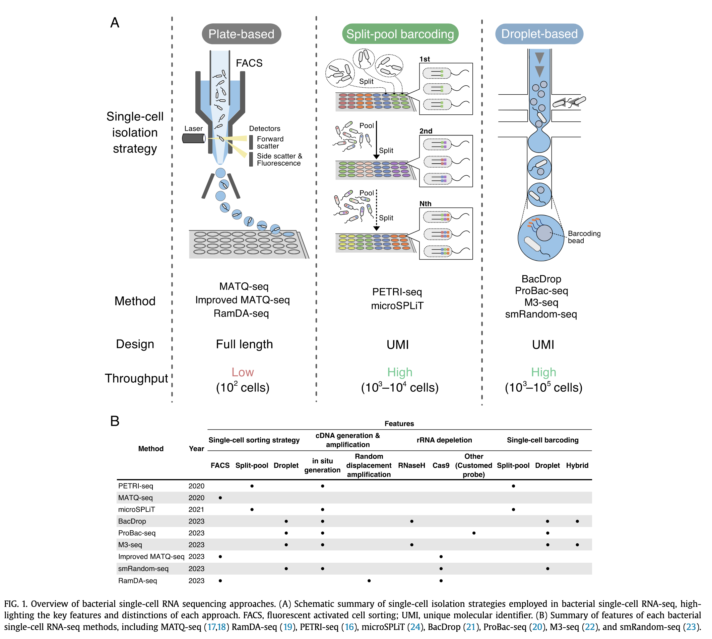
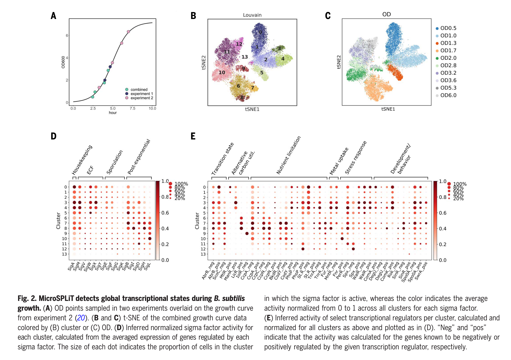
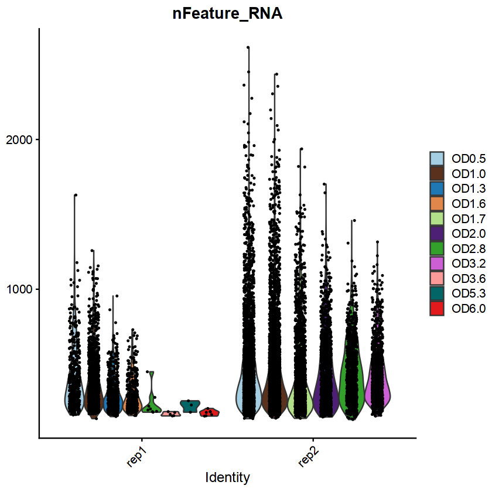
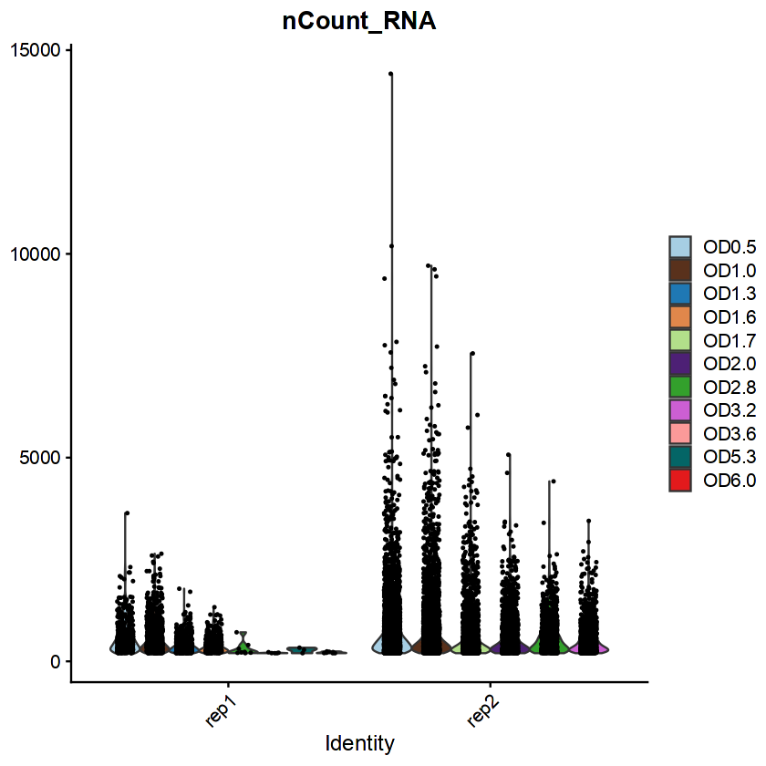
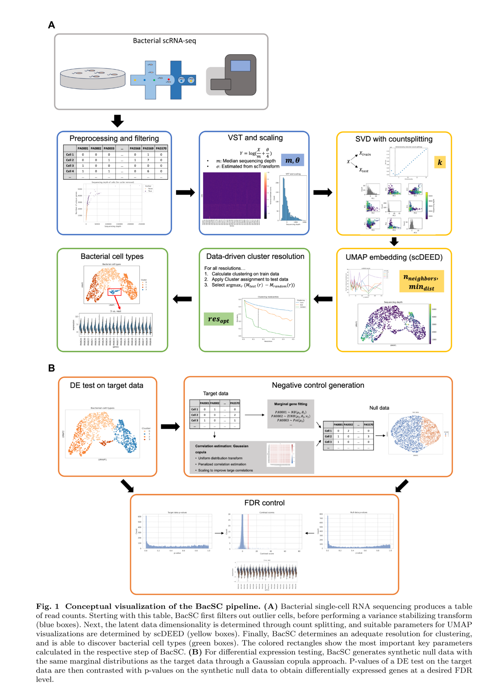
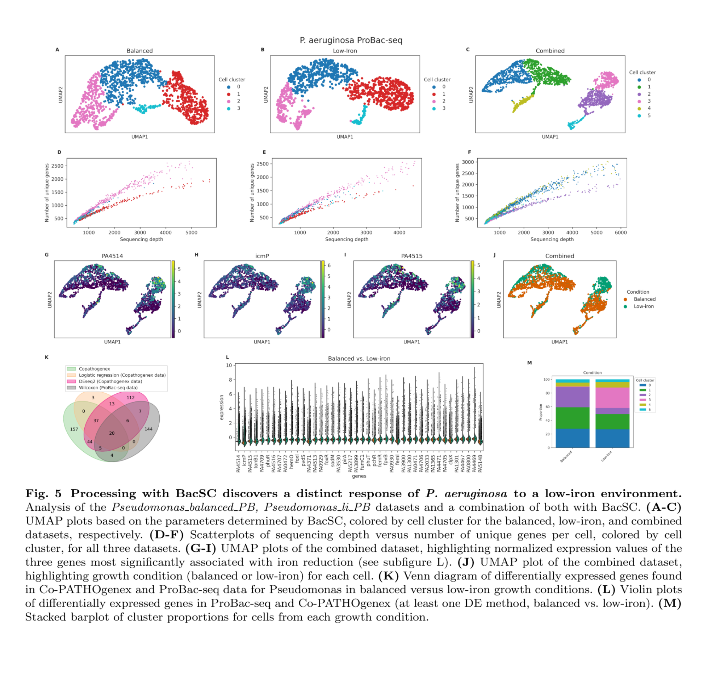

## 🔬 Who am I?

### Education

- **MSc in Plant Biology - Health & Protection** (Angers)  
  - Focus on **plant immunity**
  - Studied plant-pathogen systems:  
    - *Arabidopsis thaliana* - *Alternaria brassicicola* (role of phytocytokines)  
    - *Malus domestica* - *Erwinia amylovora* (growth-defense trade-off)   

- **MSc in Bioinformatics** (Rennes)  
  - Goal: Develop new **bioinformatics skills** for future research  

# Current Internship  
- **Started**: February 5, EcoBio (with Solène & Philippe)  
- **Topic**: **Division of Labor (DOL) in *Pseudomonas brassicacearum*** under stress  
- **Objectives**:  
  - Investigate transcriptional heterogeneity  
  - Identify different clusters in **normal conditions**  
  - Explore **new clusters** under stress (iron limitation)  

# 📚 Work Done So Far

## Literature Review

- **ANR Divide Project**  
- **Concept of Division of Labor (DOL)**  
- *Pseudomonas brassicacearum* (pathogenesis, root colonization) 

## Literature Review
- **Bacterial single-cell RNA-seq approaches**  
  - Plate-based,  droplet-based and **split-pool barcoding** strategies
  -  Challenges & limitations (low RNA levels, High rRNA content => depletion...)  

  

---

  - **Split-seq strategy**  **MicroSPLiT (Kuchina et al., 2019)**  
  
  

  

---

  - I use the data from the Kuchina et al. paper
  - **Missing metadata** in the dataset
    - => I can't analyze it !
  - But I found a **preprint** re-analyzing their data and providing metadata
  (replicates, barcodes, OD, etc.) 
    - "Single-cell heterogeneity in ribosome content and the  consequences for the growth laws"  (Leandra Brettner and Kerry Geiler-Samerotte, 2024) 
  
--- 

# Bioinformatics Pipeline for Bacterial scRNA-seq

## 1-Preprocessing
- Alignment and UMI quantification per gene  
- I found a benchmarking study comparing different tools
  -**STARsolo** is the best tool for bacterial scRNA-seq data
  - I test it on Solene's dataset
    - => output : matrix of UMI counts per gene per cell
      -  (different parameters that could be consider)
  
## 2-Data Exploration & Analysis  

- **Seurat (R)** vs **Scanpy (Python)**  
  - **Seurat**: powerful visualization (ggplot)  
  - **Scanpy**: optimized for large datasets  
  - **Interconversion** between formats is possible  

---

  - create script to add metadata to each cell the conditions
(well, condition, DO, repetition)
  - filter : rNRA tRNA... 
  - we have many cells with 0 counts : so we need to filter cell
    - => it's a manual step 
      -  nb of genes by cell 
      -  nb of UMIs by cell  (200 UMIs)

---

  
  

- **Variation in sequencing depth** across replicates and OD conditions

---

## Next Steps 
- **Benchmarking bioinformatics tools & strategies for data integration** 
  - Compare normalization, intergration and clustering strategies  
  - Evaluate **BacSC**, a pipeline for bacterial scRNA-seq
  - **Optimize workflows** for Solène’s dataset
    - **Preprint** (Oster et al., 2024) 
    - BacSC has been used on **Pseudomonas** under **low-iron conditions** (relevant for our study)
  

---

  

  

 
---

  

  

 
  
---

- **Analyze Solène’s dataset**  
  - Apply optimized workflows  
  - Identify clusters and potential **DOL signatures** under stress 

---

## Other Tasks

- **HPC cluster connection & remote computing**  
- **Building FAIR computational environments (Docker/Singularity)**  
